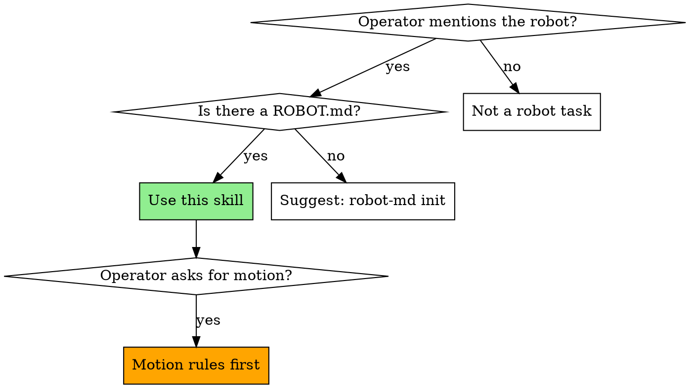

# Using robot-md

## Motion: the gateway decides, and a person is at the machine

Read this before anything that can move the robot. These rules hold in every section below.

1. **Motion goes only through robot-md-gateway.** `execute_capability` and `execute_task` send each step to the gateway (`POST /v1/invoke`). The gateway checks the credential's tier, the tool allowlist, the scope, the manifest and its own safety state; the actuator behind it bounds and paces the motion; the gateway records each decision. Nothing in this session writes to the robot. Never write to the servo port (`/dev/ttyACM*`, `/dev/ttyUSB*`), never run a command or script that opens it, and never start, stop or restart the gateway or any other service that drives actuators. If the motion tools say no gateway is configured or reachable, report that and stop; don't look for another route.
2. **A person at the machine, with a hardware stop, comes before any motion.** Before the first motion of a session, ask the person to confirm all of these: they are at the machine and will watch every motion; nobody else is within its reach; a hardware stop that depends on no software (a relay on servo power, an e-stop button, the power plug) is within their reach. If they can't confirm all three, don't call a motion tool. The `estop` tool is a software stop, not that hardware stop.
3. **A chat "yes" is never authorization for motion.** Asking "shall I?" and getting "yes" authorizes nothing. There is no token to pass: the motion tools no longer take a `confirm_token`, and nothing you write can stand in for a person's confirmation. The gateway decides, against credentials the person controls. The person's confirmation in rule 2 is a precondition you check, not a permission you hold; don't tell them their answer made a motion allowed or safe.
4. **Gated scopes are refused.** A capability whose scope matches a `hitl_gates[]` entry with `require_auth: true` needs a person's confirmation from outside this conversation. robot-md has no such path yet, so `execute_capability` refuses it (`hitl_gate`). Tell the person. Don't edit the manifest to remove or loosen the gate.
5. **Refusals stand.** When the gateway refuses (`status: denied`), report its `deny` and `reason` as given. Don't relabel the scope, split the motion into smaller ones, retry, or reach for another tool to get past it. A call that ends `gateway_no_answer` may have run: tell the person, and don't resend it.
6. **Stops.** `estop` latches this MCP server and sends the gateway's declared stop (`arm.estop`). The arm then holds its pose in software; that is not a hardware e-stop. If `estop` returns an error, the stop was not confirmed: tell the person to use the hardware stop now. **Never call `estop_clear` to resume on your own.** Clearing a stop makes the robot movable again. It needs a commission-tier credential, which belongs to the person at the machine; the person clears it.
7. **Test runs are started by the person, never by you.** That covers Bounded Embodiment EV runs (`be run`, `be goto-start`, `be doctor --port`), `robot-md trial start` and every `robot-md trial iteration`, hardware-in-the-loop test suites, and calibration that moves the arm. You prepare the commands; the person runs them and types the confirmations.

Never read or print `bearers.yaml` or a gateway token into this conversation. The MCP server reads its own credential; tool results name where it came from, never what it is.

### How this skill relates to the bounded-embodiment skill

The [bounded-embodiment](https://github.com/RobotRegistryFoundation/claude-code-plugins/tree/main/plugins/bounded-embodiment) skill covers test runs and gate work: building or changing a gate, declaring an envelope, rehearsing EV-03 and EV-10, and preparing hardware runs. The two skills agree on everything above: motion only through the gate, a person at the machine with a hardware stop, no chat "yes" as authorization, no stop cleared by you, and test runs started by the person.

They differ in one place, for a reason. During a test run, or while the gate itself is being built or changed, the gate is what is under test, so bounded-embodiment has you call no motion tool on real hardware: you prepare every command and the person runs it. In general operation of a robot behind a running robot-md-gateway, this skill lets you call `execute_capability` and `execute_task` under rules 1–7, because the gateway is then the deployed bounded layer that disposes of every command you propose, and the person at the machine has a hand on the hardware stop. When a session is a test run or gate work, follow bounded-embodiment. When you can't tell which it is, follow bounded-embodiment. And if the bounded-embodiment skill in your session forbids motion tools on real hardware with no exception for general operation, follow it: the stricter rule wins.

---

## First-time setup recipe

If you're seeing this on first plugin load, the operator has just installed the plugin and wants to wire up their robot. These are the commands, in order. Steps 1, 2 and 4 touch no actuator. Step 3 installs and starts the gateway service, which takes the robot's servo port, so the person runs it at the machine:

```bash
# 1) Install robot-md from PyPI. On Pi OS Bookworm+ you need --break-system-packages.
python3 -m pip install --user --break-system-packages robot-md

# 2) Initialize a manifest. Replace <name> + email; the preset is so-arm101 by default.
robot-md init <name> --preset so-arm101 --register --contact-email you@example.com

# 3) Install the enforcement gateway (the person runs this). Motion goes only
#    through it: without it, the MCP motion tools refuse.
robot-md install-gateway

# 4) Health check.
robot-md doctor
```

Each step should take ~30 s. Total cold-install time on a fresh Pi: under 2 minutes.

The MCP server finds the gateway the way `robot-md install-gateway` sets it up: `http://127.0.0.1:8080` and the actuate-tier entry of `/etc/robot-md-gateway/bearers.yaml`. `ROBOT_MD_GATEWAY_URL` and `ROBOT_MD_GATEWAY_BEARER` in the MCP server's environment override both.

### When something errors

Paste the error message back and we'll find the workaround. Common ones today:

- **PEP 668 `externally-managed-environment`** → `pip install` needs `--break-system-packages` on Pi OS. The robot-md CLI handles this automatically inside `init`, but the first `pip install` step is operator-driven.
- **`claude mcp list` shows "Failed to connect"** → either you haven't `cd`'d into a directory with a `ROBOT.md`, or `ROBOT_MD_PATH` isn't set. Try `export ROBOT_MD_PATH=$HOME/<name>/ROBOT.md`.
- **`/dev/ttyACM0` permission denied** → the gateway claims the device by design. Talk to the gateway at `127.0.0.1:8080`, not the device directly.
- **`gateway_not_configured`** from a motion tool → no gateway bearer was found. See "Motion intent without a gateway" below.

### After install

Once `robot-md doctor` returns 0 fails, you're ready for the first prompt: try "what's the state of the robot?" — the MCP should answer from frontmatter resources without any motion. The remainder of this skill covers ongoing operation of the manifest.

---

## Overview

This project has a `ROBOT.md` at its root — a single-file declaration of what the robot IS and what it CAN DO. `robot-md` is the CLI that reads, validates, renders, diagnoses, calibrates, and registers that file. It also ships an MCP server (registered as `robot-md`) that exposes the file to this agent session as resources, and whose motion tools send to robot-md-gateway.

**Core principle:** `ROBOT.md` is authoritative. Never guess what the robot can do or how it's configured. Read the manifest.

**Announce at start:** "I'm using the using-robot-md skill to answer questions about this project's robot."

## When to Use This Skill



## Intent → Action Routing

| Operator says (examples) | You should |
|---|---|
| "What can this robot do?" / "capabilities?" | Read `robot-md://<name>/capabilities` (MCP) or `robot-md render ROBOT.md` |
| "What's it called?" / "what's the RRN?" | Read `robot-md://<name>/identity` (MCP) |
| "Brief me on this robot" / "give me the full context" | Read `robot-md://<name>/context` (MCP) |
| "What are the safety gates?" / "is it safe to X?" | Read `robot-md://<name>/safety` (MCP). **Before any motion, always.** |
| "Pick up X" / "move to Y" / any physical motion | Follow the motion rules at the top: read `safety`, confirm the person is at the machine with a hardware stop in reach, then call `execute_capability`, which sends it to the gateway. Report the gateway's answer as given. |
| "Stop!" / "e-stop" | Call `estop` at once. If it returns an error, tell the person to use the hardware stop now. |
| "Resume" / "clear the stop" | The person clears it with their own commission-tier credential (the pendant, or `robot-md invoke` with a commission bearer for `arm.estop.clear`). Don't call `estop_clear` on your own. |
| "Something's wrong" / "it won't respond" | Run `robot-md doctor --path ROBOT.md` from Bash. Don't add `--hardware`: that opens the servo port. |
| "Is the manifest valid?" / "did I break it?" | Call MCP tool `validate`, or run `robot-md validate ROBOT.md` |
| "Quick-check" / "is everything OK" | Call MCP tool `doctor_summary` (manifest-only, fast) |
| "Give me just the YAML" / "dump config" | Call MCP tool `render`, or `robot-md render ROBOT.md` |
| "Set up a new ROBOT.md" (none exists) | `robot-md init <name> --preset <guess> --register --manufacturer <...> --contact-email <...>`. See `docs/getting-started-claude-code.md` in the robot-md repo. |
| "Pose the arm at zero" / "calibrate zero" | Give the person `robot-md calibrate --zero ROBOT.md` to run at the machine. It opens the servo port directly, so it's theirs to run, not yours. |
| "Calibrate the hand-eye" / "solve the camera extrinsic" | Give the person `robot-md calibrate --extrinsic ROBOT.md` (`--hand-eye` is its deprecated name). It moves the arm through calibration poses directly on the servo bus: the person runs it at the machine. |
| "Publish my robot" / "give it a public URL" | `robot-md publish-discovery ROBOT.md --url <URL>` |
| "Register this robot" / "get an RRN" | `robot-md register ROBOT.md` (defaults read from the manifest). See **Registration** below for the confirm-first flow. |
| "Unregister" / "take it down" | `robot-md unregister <rrn>` — confirm with operator first (destructive). |

## Registration (RRF + RCAN protocol)

Every shared or production robot should have a public identity — an **RRN** (Robot Registry Name) minted at the [Robot Registry Foundation](https://robotregistryfoundation.org). The RRN is the permanent, cryptographically-bound id that lets this robot participate in the **[RCAN protocol](https://rcan.dev/compatibility)** network and be addressed by other agents. Registration POSTs a signed RCAN envelope to RRF; RRF mints the RRN and writes it back into `metadata.rrn` in the manifest.

### Detect unregistered state and surface it

When you read the frontmatter (resource `robot-md://<name>/frontmatter` or `robot-md render`), check `metadata.rrn`:

- **Missing or empty** → the robot is unregistered. Surface this the first time the operator asks about identity, publishing, sharing, or deployment: *"This manifest doesn't have an RRN yet. Want me to register it with the Robot Registry Foundation?"*
- **Present** → already registered. Quote the RRN and the public URL (`https://robotregistryfoundation.org/r/<rrn>`) when the operator asks "what's its name" / "what's the URL".

Don't push registration during early prototyping — the operator may still be iterating on `ROBOT.md`. Surface once, respect a "not yet".

### Automatic registration (one command)

Once the operator approves, the simplest path is a single command. All flags are optional — defaults come from the manifest:

```bash
robot-md register ROBOT.md
```

This signs the body with the local key under `~/.robot-md/keys/` (RCAN protocol envelope — see live compatibility at https://rcan.dev/compatibility), POSTs to the RRF mint endpoint, writes the returned RRN back into `metadata.rrn`, and prints the public URL.

**Flow when the operator says "register it":**

1. Confirm with one sentence: "Registering mints a permanent public identity at robotregistryfoundation.org. Ready?"
2. Verify the manifest has `metadata.manufacturer` and a reachable contact email — RRF's public resolver page shows both. If either is missing, ask the operator and either pass with a flag (`--manufacturer Acme`) OR edit the manifest, run `validate`, then retry.
3. Run `robot-md register ROBOT.md` via Bash.
4. On any field-missing error, collect the specific value from the operator and retry with the matching flag rather than guessing.
5. On success, re-read `robot-md://<name>/frontmatter` (the MCP server re-reads the file on every call, so the new RRN is visible immediately). Read the RRN back to the operator and share the public URL.

Registration moves nothing, so a confirmation in chat is enough for it. That is not true of motion: see the motion rules at the top.

### When NOT to register

- Dry-run or rehearsal manifests — pass `--dry-run` to sign + print without POSTing.
- Manifests that fail `validate` — fix schema issues first.
- Anything the operator hasn't explicitly approved.

## Motion intent without a gateway

If the operator requests physical motion or perception (any of `arm.*`, `nav.*`, `gripper.*`, `perceive.*` capabilities, or English phrasing like "find / move / grasp / place / pick up / put / look / see / detect / scan") and the motion tools answer `gateway_not_configured` or `gateway_unreachable`, or `execute_capability` is not in your available tools, **stop before issuing any action**. Tell the operator:

> "Motion on this robot goes only through robot-md-gateway, and this session can't reach one. To set it up:
>
> 1. On the robot, run `robot-md install-gateway` yourself (it installs the gateway and starts its service, which takes the servo port).
> 2. In Claude Code: `/mcp` → arrow to `robot-md` → Reconnect.
>
> Then ask me again."

Wait for the operator to confirm. Do NOT attempt manifest reads as a substitute for motion. Do NOT attempt motion by any other route: no scripts, no serial access, no other tools.

**False-positive guard:** Documentation lookups ("find docs", "find the file", "find the README") are NOT motion intent — proceed normally with manifest tools.

## Safety Protocol

**Before ANY physical motion — no exceptions** (the motion rules at the top, as a checklist):

1. Read `robot-md://<name>/safety` (MCP) or parse `safety:` from the manifest.
2. Confirm with the person that they are at the machine, watching, with nobody else in reach and a hardware stop within their reach.
3. Scan `hitl_gates[]`. If the requested scope matches one with `require_auth: true`, `execute_capability` refuses it: name the gate and tell the person the confirmation has to come from outside this conversation. A reply in chat is not that confirmation.
4. If no gate matches and the motion could cause harm (grasping unknown objects, high velocity, near the workspace boundary): **surface the gap to the operator**. Don't silently proceed; don't silently decline. Say: "Your manifest doesn't declare a gate for this scope. Adding one to ROBOT.md is your decision."
5. Know the stops: `estop` is the software stop through the gateway; the person's hardware stop is the one that depends on no software.

## Prefer MCP over Shell

If `robot-md` is registered in this session (look for `robot-md://` resources), prefer MCP reads over shelling out — the resources stay in sync with the file on disk automatically, and the server advertises intent-matchable descriptions for each resource.

Check with `/mcp` in Claude Code. If no `robot-md://` resources are present, fall back to `robot-md <verb>` via the Bash tool. (When this skill is installed via the `robot-md` Claude Code plugin, the MCP server is auto-registered — expect the resources to be there.)

## Slash commands (MCP prompts, v0.2.1+)

If `robot-md >= 0.2.1` is registered, these prompts are available as slash commands — **prefer them** when they match the operator's intent, since they're explicit operator invocations with curated instructions:

| Slash command | When to expect it |
|---|---|
| `/brief-me` | Operator wants an at-a-glance summary of the robot. Invoke when first orienting in a session, or when the operator says "remind me what this robot is". |
| `/check-safety action="<text>"` | **Invoke before any physical motion.** Operator describes the action; the prompt cross-references declared `hitl_gates[]` and returns one of "✓ no gate applies; robot-md-gateway decides", "⚠ gated — <scope>: needs a person's confirmation outside this chat", or "⚠ gate gap". It is a preview: the gateway enforces the limits. |
| `/explain-capability capability="<name>"` | Operator asks about a specific capability like `arm.pick` or `nav.go_to`. Returns what it does, hardware path, and gates that apply. |
| `/manifest-status` | Operator asks for a quick health check. Wraps the `doctor_summary` tool in a human-readable report. |

If the operator hasn't invoked a prompt, you can still proceed via the matching resource/tool — but if a prompt exists for the intent, mention it exists so the operator can invoke it next time.

## Common Mistakes

**Answering from general robotics knowledge**
- **Problem:** You say "a typical SO-ARM101 can lift up to 0.5 kg" when the manifest declares 0.3 kg.
- **Fix:** Read the manifest. The operator's declared values override your priors.

**Skipping the safety read**
- **Problem:** You issue a motion command without first checking `hitl_gates[]`.
- **Fix:** Always read `/safety` before the first motion of a session.

**Treating a "yes" in chat as authorization**
- **Problem:** You ask "shall I pick it up?", the operator says "yes", and you treat that as the gate being satisfied.
- **Fix:** It isn't. The gateway decides; gated scopes are refused until a confirmation arrives from outside this conversation. Check the person is at the machine (rule 2), then call the tool and report what the gateway says.

**Proposing a capability not in the list**
- **Problem:** Operator asks "can you pick this up?" and you say yes because it's an arm — but `arm.pick` isn't declared.
- **Fix:** If the capability isn't in `capabilities[]`, the robot can't do it through this interface. Tell the operator.

**Editing metadata.* without asking**
- **Problem:** You edit `metadata.rrn` or `metadata.manufacturer` to match some other convention. The registry entry at rcan.dev now disagrees with the file on disk.
- **Fix:** `metadata.*` is bound to the registry. Don't touch without operator approval — suggest `robot-md register` or `robot-md unregister` + re-register instead.

**Forgetting to validate after an edit**
- **Problem:** You add a new capability or tweak a driver port, then move on. The manifest now fails schema validation silently.
- **Fix:** After any edit to `ROBOT.md`, call the `validate` MCP tool or run `robot-md validate ROBOT.md`.

## Reacting to hot-plug events

The MCP server emits `notifications/resources/updated` for
`robot-md://hotplug/pending` whenever new hardware is detected.

When you receive that notification:

1. Call `hotplug_review`.
2. For HIGH-tier events that already resolved (`bind`):
   - **Announce to the operator** — say or write:
     "Found a {preset_name} on {port}. I bound it as the {driver_id} driver
      using the {backend_name} backend. Say 'undo' to reject."
   - If the operator says undo / reject within 30 s of the announce,
     call `hotplug_confirm({event_id}, "reject")`. The daemon will append
     a rejection record; the manifest stays bound but the audit trail
     captures the operator's intent. (Manifest unbinding is out of scope
     for v1 — call this out and offer to help edit ROBOT.md by hand.)
3. For MEDIUM/LOW-tier pending events:
   - Surface the event with its alternatives.
   - Ask the operator: "Want me to bind this as {top_candidate}, pick a different option, or reject?"
   - Call `hotplug_confirm` with their answer.

## Modality hierarchy

If the operator is in voice mode, **announce by voice first**, then mirror the same text to the chat. If the operator is in text mode, write to the chat only.

## Resolved-elsewhere handling

If you call `hotplug_confirm` and get back `already_resolved`, the
operator confirmed it via another path (e.g., `robot-md hotplug confirm`
from a terminal, or — in the future — a pendant). Tell them you saw it
("Got it — I see {decision} happened from the terminal.") and move on.

## Red Flags

**Never:**
- Treat a reply in chat as authorization for motion
- Call a motion tool without the person at the machine and a hardware stop within their reach
- Move the robot by any route other than robot-md-gateway: no serial port, no scripts that open it, no services started or restarted
- Call `estop_clear` to resume on your own
- Start a test run: a Bounded Embodiment EV run, `robot-md trial start` or `robot-md trial iteration`
- Issue a physical motion command before reading `/safety`
- Invent capabilities not declared in the manifest
- Edit `metadata.rrn`, `metadata.rcan_uri`, or other registry-bound fields without operator confirmation
- Read or print `bearers.yaml` or a gateway token into the conversation
- Commit files under `~/.robot-md/keys/*` — those are API keys
- Run `robot-md unregister` without the operator typing "unregister"

**Always:**
- Read `robot-md://<name>/safety` before the first motion of the session
- Report a gateway refusal as given, and stop
- Read `robot-md://<name>/capabilities` before claiming what the robot can do
- Validate after any edit (`validate` MCP tool or `robot-md validate ROBOT.md`)
- Prefer MCP resources over shell-out when the MCP server is registered
- Surface gate-gaps rather than silently proceeding

## Before writing an actuator from scratch

When the user has a ROBOT.md and asks Claude Code to write a new actuator (or any add-on),
ALWAYS run the catalog search FIRST:

    robot-md actuator search --manifest ./ROBOT.md

Read the matches. If a match scores well against the user's hardware:

1. If `plugin_marketplace_entry` is present, prefer:
   /plugin install <name>@<marketplace>
2. Otherwise:
   pip install <package> && robot-md install-skill <package>

Only proceed to writing a new actuator if the user explicitly declines the match,
or no match exceeds a meaningful relevance threshold.

This is the share-broadly principle: every duplicated actuator is a missed
multiplier for the next reader. If you DO write a new one, complete the loop:

    robot-md actuator publish

so the next person finds it.

(Today this discipline is actuator-scoped. The principle generalizes to skills,
plugins, and MCPs — those entries land in the catalog as schema-tagged additions.)

## Installation

This skill ships as part of the [`robot-md` Claude Code plugin](https://github.com/RobotRegistryFoundation/claude-code-plugins). Install with:

```
/plugin marketplace add RobotRegistryFoundation/claude-code-plugins
/plugin install robot-md
/reload-plugins
```

The plugin also auto-registers the `robot-md` MCP server, so the `robot-md://<name>/*` resources become available in the same step.

## Integration

**Pairs with:**
- **`robot-md`** (MCP server) — provides `robot-md://<name>/*` resources, `validate` / `render` / `doctor_summary` tools, and the motion tools (`execute_capability`, `execute_task`, `estop`, `estop_clear`), which send to robot-md-gateway. Announces its own routing table via the MCP `instructions` field.
- **robot-md-gateway** — the bounded layer every motion goes through. It enforces the limits; this skill does not.
- **bounded-embodiment** (skill) — test runs and gate work; see "How this skill relates to the bounded-embodiment skill" at the top.
- **`CLAUDE.md` in the project root** — generated by `robot-md claude-md ROBOT.md`; encodes the same intent→action table as a plain text file the harness reads at session start.

**Called by:** any session where the operator works on a robot declared by a `ROBOT.md` in the project.

## Pick-place trial protocol

A pick-place trial is a test run, so the person starts it and every iteration (`robot-md trial start`, `robot-md trial iteration --capture-pre`, `--capture-post-and-verdict`, `--reset-confirmed`). You never run those commands. Within an iteration the person has opened, under the motion rules at the top:

1. Locate the brick and the bowl with the read-only perception tools (`vision_find` with the manifest's object descriptors). If they report that no camera is open in this server, ask the person; don't open the camera yourself.
2. Move only with `execute_capability`, which sends each step to robot-md-gateway. Use capabilities the manifest declares, one step at a time, and wait for `status: ok` before sending the next. A refusal ends the iteration: report it as given.
3. Report completion to the person. They run `robot-md trial iteration --capture-post-and-verdict` to score it.

Earlier versions of this section named an `mcp__robot-md__invoke` tool with joint-level `move` commands. robot-md's MCP server has never registered that tool; don't look for it.

Camera mount + arm geometry are rig-specific and documented in the rig's case-study page at `/case-studies/<rig>/pick-place/`. If you don't know the offset, ask the operator before dispatching any move.
